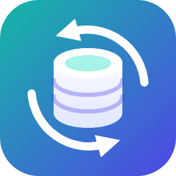

<p align="center"></p>

<h1 align="center">DataFlip</h1>

**A full database IDE inside VS Code.** Connect, browse, query, filter and edit PostgreSQL, MySQL, SQL Server, SQLite and BigQuery without leaving your editor.

## Features

- **Every database in one sidebar.** Browse servers, databases, schemas, tables and columns, with primary keys and types at a glance.
- **Smart autocomplete.** Tables, columns and aliases from your live schema, quoted correctly for each database.
- **Run what's under the cursor.** `Cmd/Ctrl+Enter` executes the current statement or selection; results open in a fast grid.
- **Excel-style filters.** Pick values from a column's dropdown, with counts, search and sorting. Filters run in the database across the whole table.
- **Edit data in place.** Change cells, add and delete rows, then submit everything in one safe transaction.
- **Change your schema.** Add, rename and drop columns from the tree.
- **Consoles and history that stick around.** Every console is saved, and every query you run is one click away from running again.
- **Secure by default.** Passwords stay in your OS keychain.

## Supported databases

PostgreSQL · MySQL / MariaDB · SQL Server · SQLite · Google BigQuery

## Getting started

1. Open the **Database** view in the activity bar.
2. Click **+ Add Data Source** and enter your connection details.
3. Open a **Query Console** from the data source and start typing.

## Development

```bash
npm install
npm test
```

Press `F5` in VS Code to launch an Extension Development Host.
